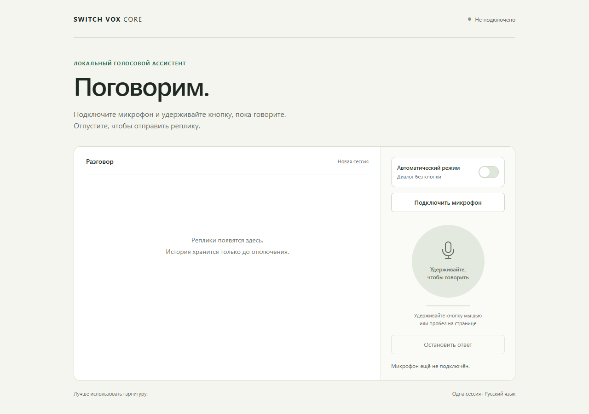
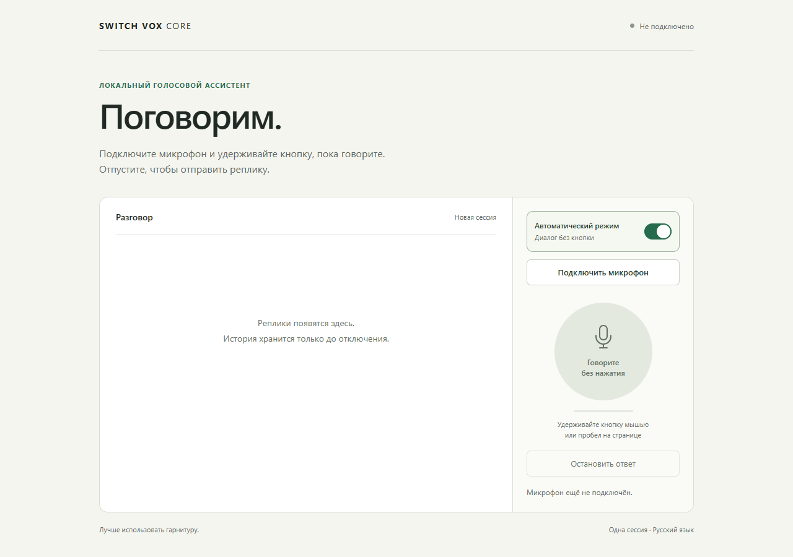
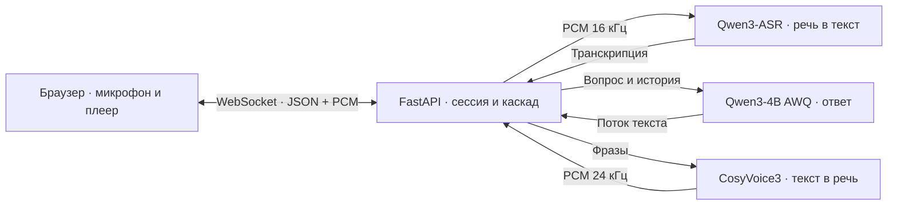

<div align="center">

# Switch Vox Core

**Русскоязычный голосовой ассистент, который работает на вашей GPU.**

Микрофон → распознавание речи → языковая модель → потоковый голосовой ответ.


[Быстрый старт](#быстрый-старт) · [Возможности](#возможности) · [Архитектура](#архитектура) · [Разработка](#разработка)

</div>



## Возможности

Switch Vox Core объединяет три локальные модели в голосовой диалог с браузером. После загрузки весов распознавание, генерация ответа и синтез речи выполняются локально, без облачных API.

- **Два способа разговаривать.** Удерживайте кнопку или Space в режиме Push-to-Talk либо включите автоматический режим до подключения микрофона.
- **Потоковый ответ.** Текст разбивается на короткие фразы и сразу передаётся в TTS; браузер воспроизводит поступающие PCM-кадры.
- **Автоматические границы реплик.** Silero VAD на CPU определяет речь и паузы; по умолчанию пауза 640 мс завершает вопрос.
- **Перебивание.** В автоматическом режиме новый вопрос останавливает текущий ответ. Кнопка «Остановить ответ» доступна в обоих режимах.
- **Память разговора.** В контекст попадают подтверждённые услышанные фразы. История живёт в памяти сессии и удаляется при отключении.
- **Свой голос.** CosyVoice3 поддерживает настройку по референсной записи и её точной транскрипции.

<details>
<summary><strong>Скриншот: автоматический режим без удерживания кнопки</strong></summary>



Режим выбирается до подключения микрофона и сохраняется на время сессии. Скриншоты сняты с работающего браузерного клиента.

</details>

## Быстрый старт

### Что потребуется

- Docker Engine с Compose и доступом контейнеров к NVIDIA GPU; на Windows — Docker Desktop с Linux engine и WSL2.
- NVIDIA GPU с **16 ГиБ VRAM**: конфигурация проверялась на RTX 4070 Ti SUPER. Другие GPU и меньший объём памяти требуют отдельной проверки.
- Доступ к Hugging Face при первой загрузке моделей, минимум 20 ГиБ для `data/` и дополнительное место для CUDA-образов и кэша Docker.
- Современный браузер с AudioWorklet и микрофоном. Для диалога удобнее гарнитура.

Из корня проекта выполните:

```bash
docker compose up --build -d
```

Compose соберёт приложение и модельные сервисы. Контейнер `model-init` подготовит закреплённые версии моделей в `data/`, затем последовательно запустятся ASR, LLM и TTS. При первом запуске загрузка весов и сборка CUDA-образов могут занять значительное время. Готовые модели используются повторно.

Загрузчик проверяет версию и наличие обязательных непустых файлов, включая части весов из индекса. Это не проверка целостности содержимого: повреждённые веса могут быть отклонены модельным сервисом. Для повторной загрузки такого snapshot остановите каскад и переместите соответствующий каталог из `data/`.

```bash
# Состояние сервисов: model-init должен завершиться с кодом 0, остальные — стать healthy.
docker compose ps -a

# Прогресс подготовки весов и запуска моделей.
docker compose logs -f model-init asr llm tts
```

После готовности откройте **[http://127.0.0.1:8000](http://127.0.0.1:8000)** и разрешите доступ к микрофону.

| Адрес | Назначение |
| --- | --- |
| [`/`](http://127.0.0.1:8000/) | Браузерный голосовой клиент |
| [`/docs`](http://127.0.0.1:8000/docs) | Интерактивная документация HTTP API |
| [`/health/live`](http://127.0.0.1:8000/health/live) | Доступность процесса приложения |
| [`/health/ready`](http://127.0.0.1:8000/health/ready) | Готовность обработчика и всех моделей; HTTP 503 до готовности |

Остановить сервисы можно командой `docker compose stop`. Веса в `data/` и кэши сохраняются.

## Архитектура



| Сервис | Роль |
| --- | --- |
| `model-init` | Однократная подготовка весов на CPU; доступ к сети нужен при загрузке |
| `asr` | Qwen3-ASR-0.6B и WebSocket-шлюз распознавания речи |
| `llm` | Qwen3-4B-AWQ с OpenAI-совместимым API vLLM |
| `tts` | Fun-CosyVoice3-0.5B с потоковой выдачей аудио |
| `app-cascade` | FastAPI, управление диалогом, VAD и браузерный клиент |

Модельные сервисы работают во внутренней сети без опубликованных портов, читают веса из `data/` и используют одну GPU. Порядок запуска ограничивает одновременную загрузку моделей. С хоста доступен только порт приложения `127.0.0.1:8000`.

Основное приложение использует Python 3.15 и `uv`. У ASR/vLLM и CosyVoice собственные окружения: их CUDA/PyTorch-зависимости не устанавливаются в окружение FastAPI. Собственный Python-код сериализует JSON через `orjson`; типизированные HTTP-ответы основного FastAPI используют нативную сериализацию Pydantic.

## Настройка

Для запуска с настройками по умолчанию `.env` не обязателен. Пример доступен в [`.env.example`](.env.example); копируйте его только при отсутствии собственного файла.

### Голос TTS

Положите референсную запись в `data/fixtures/reference.wav` и задайте в `.env` обе переменные:

```dotenv
TTS_REFERENCE_WAV=/models/fixtures/reference.wav
TTS_REFERENCE_TEXT=Точный текст, произнесённый на записи.
```

Запись должна быть не длиннее 30 секунд, с частотой не ниже 16 кГц. Используйте голос, на применение которого у вас есть разрешение. При пустых значениях используется комплектный референс CosyVoice3; неполная пара настроек отклоняется.

```bash
docker compose up -d --no-deps tts
```

### Адреса моделей

`asr_base_url`, `llm_base_url` и `tts_base_url` указывают, куда приложение обращается за распознаванием, генерацией текста и озвучиванием. Compose уже задаёт их через имена сервисов:

| Настройка | Адрес внутри Compose | Использование |
| --- | --- | --- |
| `INFERENCE__ASR_BASE_URL` | `http://asr:8000` | WebSocket `/v1/realtime`, проверка `/health` |
| `INFERENCE__LLM_BASE_URL` | `http://llm:8000/v1` | Генерация `/chat/completions`; `/health` и `/tokenize` без `/v1` |
| `INFERENCE__TTS_BASE_URL` | `http://tts:8000` | Отправка текста на `/synthesize`, получение потока аудио |

Все параметры приложения описаны в [`sources/settings.py`](sources/settings.py). Корневой `.env` читается при запуске Python и передаётся приложению через необязательный `env_file` в Compose. Вложенные имена разделяются `__`. Явные значения секции `environment` в Compose имеют приоритет: адрес привязки внутри контейнера, порт, число процессов, режим и адреса моделей задаются там.

## Журналы

Loguru записывает сообщения в консоль и необязательный файл через фоновые очереди. При остановке сервисы дожидаются завершения записи. События сессии и стадий ASR/LLM/TTS содержат идентификаторы для сопоставления, счётчики и длительности; тексты разговоров, аудио и содержимое ошибок внешних сервисов не записываются.

Для подробной диагностики задайте в `.env` `LOGING_SETTINGS__CONSOLE_LEVEL=DEBUG` для приложения и `RUNTIME_LOG_LEVEL=DEBUG` для ASR, TTS и подготовки моделей. Настройки файла приложения: `LOGING_SETTINGS__FILE_PATH`, `LOGING_SETTINGS__FILE_LEVEL`, `LOGING_SETTINGS__ROTATION` и `LOGING_SETTINGS__RETENTION`. По умолчанию файловый журнал выключен. Изменения окружения применяются командой `docker compose up -d`.

## Структура проекта

```text
sources/                 FastAPI, настройки, сессии и модельные клиенты
static/                  Браузерный интерфейс, AudioWorklet и аудиопротокол
deploy/
  asr/                   Dockerfile, ASR-шлюз и запуск vLLM backend
  llm/                   Параметры запуска текстовой модели
  cosyvoice/             Dockerfile, TTS-сервер и адаптация CosyVoice3
  models/                Образ и скрипт подготовки закреплённых весов
test/                    Тесты приложения и Compose
docs/                    Иллюстрации и документация
```

`deploy/` содержит рабочие исходники и зависимости контейнеров. Compose описывает, **как связать и запустить** сервисы, а Dockerfile и код из `deploy/` — **что внутри них работает**. Папка необходима для сборки проекта.

## Разработка

Для приложения нужны Python 3.15.1 и [uv](https://docs.astral.sh/uv/):

```bash
uv sync --locked
uv run python sources/main.py
```

Запуск Python поднимает только приложение. Для голосового диалога ему нужны доступные модельные сервисы; имена `asr`, `llm`, `tts` разрешаются внутри сети Compose. Самостоятельную разработку протокола и логики можно вести через тесты без загрузки моделей.

```bash
uv run pytest --cov=sources --cov-report=term-missing
uv run ruff check sources test deploy
uv run ruff format --check sources test deploy
uv run mypy
node --test static/test/audio-core.test.mjs static/test/latency.test.mjs static/test/analyze-acceptance.test.mjs
```

Изолированные тесты подготовки моделей и TTS запускаются в соответствующих окружениях контейнеров. Устройство сервисов описано в [архитектуре](docs/architecture.md), события WebSocket — в [протоколе](docs/protocol.md).

CPU-тесты загрузчика можно выполнить без установки модельных зависимостей в окружение приложения:

```bash
uv run --no-project --with huggingface-hub==0.36.2 --with orjson==3.13.0 --with pytest==9.2.0 python -m pytest deploy/models/test -q
```
