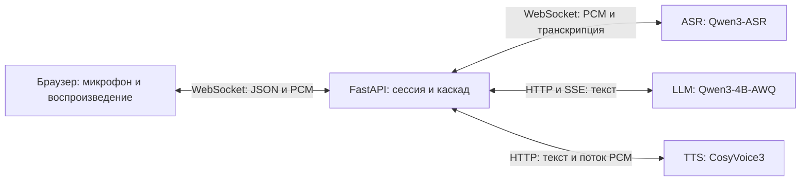

# Архитектура

Switch Vox Core запускает локальный каскад распознавания речи, генерации текста и синтеза голоса. Основное приложение не загружает модельные веса: для каждой роли работает отдельный контейнер со своим окружением. Поддерживается один API-процесс и одна активная голосовая сессия.

## Сервисы и запуск

Обычная команда `docker compose up --build -d` запускает весь каскад. Имена контейнерных сервисов используются как сетевые адреса; с хоста опубликован только `127.0.0.1:8000`.

| Сервис | Ответственность |
|---|---|
| `model-init` | Загружает закреплённые версии моделей в `data/`, проверяет комплектность и завершает работу. Полный локальный snapshot повторно используется без сети. |
| `asr` | Принимает PCM через WebSocket `/v1/realtime`; внутренний vLLM распознаёт растущий префикс записи и возвращает заменяемые гипотезы и финальный текст. |
| `llm` | Предоставляет vLLM `/v1/chat/completions` и `/tokenize`; выдаёт текст ответа через SSE. |
| `tts` | Принимает короткие текстовые фразы через `/synthesize`, возвращает поток PCM16 LE mono 24 кГц. |
| `app-cascade` | Раздаёт браузерный клиент, управляет сессией, VAD, историей и клиентами моделей. |

Модели начинают работу после успешного `model-init`. Затем ASR, LLM и TTS загружаются последовательно через зависимости готовности, уменьшая одновременный пик потребления VRAM. Все три используют GPU 0, читают модели из `data/` без права записи и работают во внутренней сети `voice` без внешнего доступа. `model-init` имеет внешнюю сеть для загрузки, не использует GPU и может записывать только в каталог моделей и временный каталог. Приложение соединяет внутреннюю модельную сеть с сетью входа пользователя.

Версии образов и библиотек закреплены в Dockerfile и lock-файлах. При первом запуске нужны интернет и место для моделей и образов. Отказ загрузки не создаёт маркер готовности; повторный запуск продолжает подготовку. Каталог с маркером другой модели или версии автоматически не перезаписывается. Проверка комплектности не заменяет проверку целостности содержимого весов.

## Обработка разговора

Режим приложения фиксируется при запуске: реализован `cascade`; для `e2e` обработчик отсутствует и readiness остаётся отрицательной. Независимо от этого браузер выбирает режим ввода `ptt` или `auto` на всю сессию.

В PTT браузер начинает передавать PCM после подтверждения `input.started`. После отпускания кнопки он сначала отправляет последний кадр AudioWorklet, затем `input.commit`. В автоматическом режиме микрофон передаёт непрерывный поток, а серверный CPU VAD определяет начало и конец реплики, сохраняет начало речи до подтверждения и останавливает прежний ответ при новой подтверждённой речи.

После финальной транскрипции клиент LLM подготавливает историю и проверяет размер контекста тем же tokenizer, что используется генерацией. Ответ разбивается на короткие фразы. Ограниченная очередь фраз позволяет LLM и TTS работать с перекрытием, не накапливая произвольный объём текста или аудио.

Каждая генерация и каждая озвучиваемая фраза имеют свои идентификаторы. Отмена инвалидирует текущую генерацию, очищает очереди и закрывает модельные потоки. Браузер отбрасывает устаревшие кадры и очищает воспроизведение. Уже начатая транспортная пара заголовок/PCM при этом дочитывается согласованно.

История хранится в памяти текущей сессии. В неё входит непрерывный префикс целых фраз, полностью подтверждённых через `playback.progress`, а не весь заранее сгенерированный ответ. Переподключение создаёт новую сессию без прежней истории.

## Границы ответственности

- [`sources/api`](../sources/api/) — HTTP/WebSocket-маршруты, схемы и сборка приложения.
- [`sources/services`](../sources/services/) — единственный владелец состояния сессии, VAD и каскад.
- [`sources/clients`](../sources/clients/) — конкретные сетевые протоколы ASR, LLM и TTS.
- [`static`](../static/) — интерфейс, ресемплирование, управление AudioWorklet и подтверждение воспроизведения.
- [`deploy`](../deploy/) — исходники модельных сервисов, закреплённые зависимости и сборка контейнеров.

Приложение отдаёт `/health/live` для проверки API-процесса и `/health/ready` для проверки обработчика и модельных endpoint. Доступность страницы или успешный WebSocket handshake сами по себе не означают готовность моделей. Управляющий протокол описан в [protocol.md](protocol.md).
